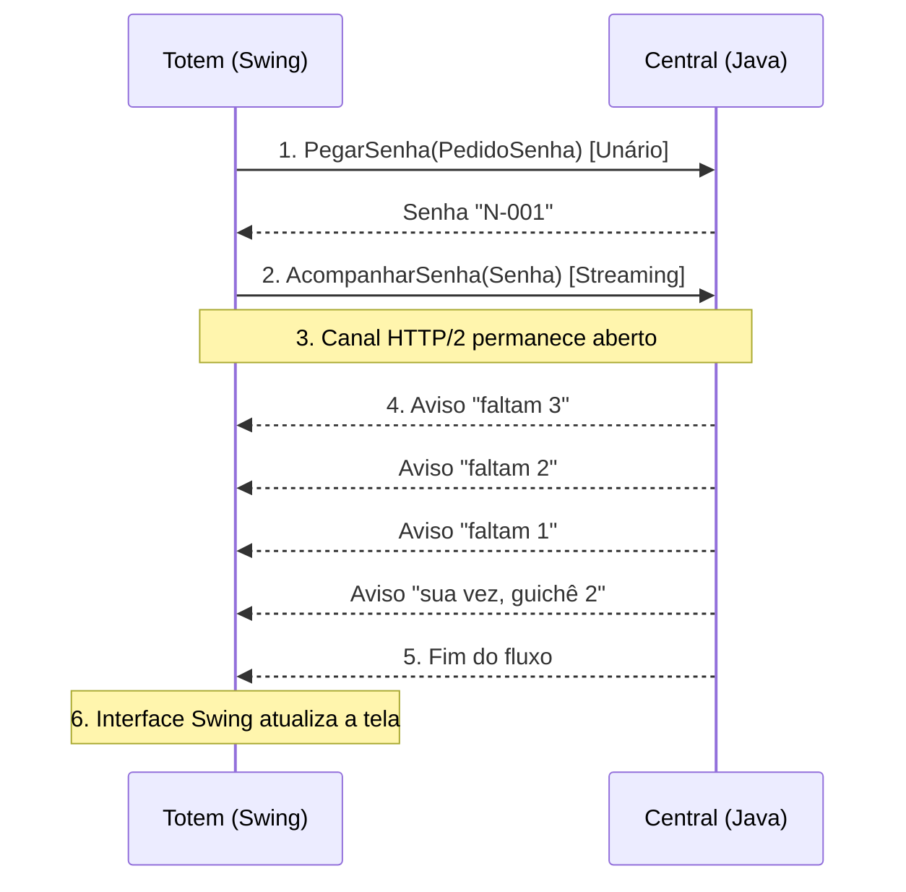

# PROMPTS.md: Central de Senhas com gRPC (Callback / Server Streaming)

Registro cronológico dos prompts enviados à IA no projeto de Sistemas Distribuídos, com espaços para o grupo registrar as respostas e decisões. O material técnico gerado nas respostas está reunido nos anexos, ao final.

> **Notas**
> - Conforme a instrução anterior de descartar um trecho da conversa, esse trecho **não** foi incluído.
> - Os campos de "Registro da resposta e das decisões do grupo" estão vazios de propósito, para preenchimento manual.
> - O `initComponents()` do `TelaTotem.java` é código gerado pelo NetBeans: aparece completo no Prompt 4 (código original enviado) e abreviado no Anexo D.
> - Elementos visuais (fluxogramas, slides) foram convertidos para ASCII, Mermaid e tabelas.

## Sumário

| Seção | Conteúdo |
|---|---|
| [Prompt 1](#prompt-1--pedido-inicial-e-parte-1-arquivo-proto) | Pedido inicial e Parte 1 (`.proto`) |
| [Prompt 2](#prompt-2--explicação-didática-da-parte-1-e-proto-idêntico) | Explicação didática da Parte 1 e `.proto` idêntico |
| [Prompt 3](#prompt-3--parte-2-central-servidor) | Parte 2: Central (Servidor) |
| [Prompt 4](#prompt-4--parte-3-totem-cliente-telatotemjava) | Parte 3: Totem (`TelaTotem.java`) |
| [Prompt 5](#prompt-5--roteiro-de-fala-da-parte-1-da-apresentação) | Roteiro de fala da Parte 1 da apresentação |
| [Prompt 6](#prompt-6--conteúdo-dos-slides-da-parte-1) | Conteúdo dos slides da Parte 1 |
| [Prompt 7](#prompt-7--geração-do-arquivo-final-dos-slides) | Geração do arquivo final dos slides |
| [Prompt 8](#prompt-8--conversão-da-conversa-em-promptsmd) | Conversão da conversa em `PROMPTS.md` |
| [Prompt 9](#prompt-9--reorganização-do-promptsmd-por-prompt) | Reorganização do `PROMPTS.md` por prompt |
| [Anexos](#anexos--material-técnico-gerado-nas-respostas) | Material técnico gerado nas respostas |

---

## Prompt 1 — Pedido inicial e Parte 1: arquivo `.proto`

### Prompt enviado à IA

Sou estudante de Sistemas Distribuídos. Tenho este projeto gRPC em Java (código abaixo). Quero acrescentar o recurso de Callback (Server Streaming) da forma MAIS SIMPLES possível, no mesmo estilo, sem bibliotecas extras (sem Spring, sem banco de dados). Faça uma parte por vez e explique cada linha do código em português.

Especificação do que deve ser acrescentado:

1. No arquivo .proto:
   - Criar a mensagem Aviso (ex: string mensagem = 1;).
   - Adicionar o método rpc AcompanharSenha (Senha) returns (stream Aviso);.
2. Na Central (Servidor):
   - Implementar o método AcompanharSenha enviando mensagens sequenciais no mesmo fluxo de resposta (ex: "faltam 3", "faltam 2", "sua vez, guichê 2").
   - Tratar o cancelamento caso o totem seja fechado no meio do envio (registrar o cancelamento na Central).
3. No Totem (Cliente):
   - Criar a chamada assíncrona para receber e exibir os avisos do stream em tempo real sem precisar fazer novas requisições.

Também preciso que me explique didaticamente:

- A diferença entre Unário (1 → 1) e Server Streaming (1 → várias respostas).
- Por que usamos StreamObserver e não return.
- Como a Central consegue enviar múltiplos avisos sem o totem fazer novas perguntas.
- Exemplos de usos reais na indústria (painel de senhas, notificações push).

Base do contrato atual (atendimento.proto):

```protobuf
syntax = "proto3";
package atendimento;
option java_package = "com.mycompany.atendimentorpc";
option java_multiple_files = true;
service AtendimentoService {
 rpc PegarSenha (PedidoSenha) returns (Senha);
}
enum TipoAtendimento {
 NORMAL = 0;
 PRIORITARIO = 1;
}
message PedidoSenha {
 string nome = 1;
 TipoAtendimento tipo = 2;
 string local = 3;
}
message Senha {
 int32 numero = 1;
 string codigo = 2;
 string mensagem = 3;
}
```

Base do serviço atual (AtendimentoServiceImpl.java):

```java
package com.mycompany.servidoratendimentorpc;
import com.mycompany.atendimentorpc.AtendimentoServiceGrpc;
import com.mycompany.atendimentorpc.PedidoSenha;
import com.mycompany.atendimentorpc.Senha;
import com.mycompany.atendimentorpc.TipoAtendimento;
import io.grpc.stub.StreamObserver;
public class AtendimentoServiceImpl extends AtendimentoServiceGrpc.AtendimentoServiceImplBase {
 private int proximoNumero = 1;
 private synchronized int gerarNumero() {
 return proximoNumero++;
 }
 @Override
 public void pegarSenha(PedidoSenha req, StreamObserver<Senha> observador) {
 int numero = gerarNumero();
 String prefixo = req.getTipo() == TipoAtendimento.PRIORITARIO ? "P" : "N";
 String codigo = String.format("%s-%03d", prefixo, numero);
 String mensagem = req.getNome() + ", sua senha é " + codigo + " (totem: " + req.getLocal() + ")";
 Senha resposta = Senha.newBuilder().setNumero(numero).setCodigo(codigo).setMensagem(mensagem).build();
 observador.onNext(resposta);
 observador.onCompleted();
 }
}
```

Por favor, forneça primeiro apenas as alterações do arquivo .proto com as explicações linha por linha, para irmos passo a passo.

### Registro da resposta e das decisões do grupo

**O que a IA respondeu:**

[ESPAÇO PARA PREENCHIMENTO PELO GRUPO]

**O que aceitamos da resposta:**

[ESPAÇO PARA PREENCHIMENTO PELO GRUPO]

**O que mudamos ou recusamos:**

[ESPAÇO PARA PREENCHIMENTO PELO GRUPO]

**Por quê?**

[ESPAÇO PARA PREENCHIMENTO PELO GRUPO]

---

## Prompt 2 — Explicação didática da Parte 1 e `.proto` idêntico

### Prompt enviado à IA

Nessa parte 1, explique de forma didática o que aconteceu no código. Também aponte regras, características, conceitos ou detalhes que fazem a diferença ou são minimamente relevantes. OS documentos atendimentos.photo devem ser idênticos no servidor e cliente mas vc n deu ênfase nisso, pq?

### Registro da resposta e das decisões do grupo

**O que a IA respondeu:**

[ESPAÇO PARA PREENCHIMENTO PELO GRUPO]

**O que aceitamos da resposta:**

[ESPAÇO PARA PREENCHIMENTO PELO GRUPO]

**O que mudamos ou recusamos:**

[ESPAÇO PARA PREENCHIMENTO PELO GRUPO]

**Por quê?**

[ESPAÇO PARA PREENCHIMENTO PELO GRUPO]

---

## Prompt 3 — Parte 2: Central (Servidor)

### Prompt enviado à IA

N quero. Agora vamos para a segunda parte: a Central (Servidor).

Com base no .proto atualizado, preciso implementar o método AcompanharSenha na classe AtendimentoServiceImpl.
A Central deve enviar mensagens sequenciais no mesmo fluxo de resposta ("faltam 3", "faltam 2", "sua vez, guichê 2").
Se o totem for fechado durante a transmissão, a Central deve detectar e registrar o cancelamento.

Por favor, forneça o código atualizado da classe AtendimentoServiceImpl e explique cada linha em português, sem utilizar bibliotecas extras.

### Registro da resposta e das decisões do grupo

**O que a IA respondeu:**

[ESPAÇO PARA PREENCHIMENTO PELO GRUPO]

**O que aceitamos da resposta:**

[ESPAÇO PARA PREENCHIMENTO PELO GRUPO]

**O que mudamos ou recusamos:**

[ESPAÇO PARA PREENCHIMENTO PELO GRUPO]

**Por quê?**

[ESPAÇO PARA PREENCHIMENTO PELO GRUPO]

---

## Prompt 4 — Parte 3: Totem (Cliente), `TelaTotem.java`

### Prompt enviado à IA

Agora vamos para a terceira e última parte: o Totem (Cliente).

Preciso atualizar a classe da interface gráfica (TelaTotem.java) para que, após pegar a senha, ela chame o método de streaming AcompanharSenha para receber os avisos da Central em tempo real ("faltam 3", "faltam 2", "sua vez, guichê 2") e atualize a mensagem na tela sem travar a interface e sem precisar de novas requisições.

Por favor, forneça o código completo da classe TelaTotem.java atualizado, mantendo a estrutura Swing e explicando cada linha em português.

Aqui está o código atual da classe TelaTotem.java:

```java
/*
 * Click nbfs://nbhost/SystemFileSystem/Templates/Licenses/license-default.txt to change this license
 * Click nbfs://nbhost/SystemFileSystem/Templates/GUIForms/JFrame.java to edit this template
 */
package com.mycompany.clienteatendimentorpc;

import com.mycompany.atendimentorpc.AtendimentoServiceGrpc;
import com.mycompany.atendimentorpc.PedidoSenha;
import com.mycompany.atendimentorpc.Senha;
import com.mycompany.atendimentorpc.TipoAtendimento;
import io.grpc.ManagedChannel;
import io.grpc.ManagedChannelBuilder;
import io.grpc.StatusRuntimeException;
import java.util.concurrent.TimeUnit;
import javax.swing.JOptionPane;

public class TelaTotem extends javax.swing.JFrame {

    private final ManagedChannel canal;
    private final AtendimentoServiceGrpc.AtendimentoServiceBlockingStub stub;

    public TelaTotem() {
        initComponents();
        canal = ManagedChannelBuilder
                .forAddress("localhost", 50051)
                .usePlaintext()   // sem TLS: só no laboratório
                .build();
        stub = AtendimentoServiceGrpc.newBlockingStub(canal);
        Runtime.getRuntime().addShutdownHook(new Thread(canal::shutdown));
    }

    /**
     * This method is called from within the constructor to initialize the form.
     * WARNING: Do NOT modify this code. The content of this method is always
     * regenerated by the Form Editor.
     */
    @SuppressWarnings("unchecked")
    // <editor-fold defaultstate="collapsed" desc="Generated Code">                          
    private void initComponents() {

        grupoTipo = new javax.swing.ButtonGroup();
        painelFundo = new javax.swing.JPanel();
        painelCabecalho = new javax.swing.JPanel();
        lblMarca = new javax.swing.JLabel();
        lblTitulo = new javax.swing.JLabel();
        lblLocal = new javax.swing.JLabel();
        cbxLocal = new javax.swing.JComboBox<>();
        lblNome = new javax.swing.JLabel();
        tfNome = new javax.swing.JTextField();
        lblTipo = new javax.swing.JLabel();
        rbNormal = new javax.swing.JRadioButton();
        rbPrioritario = new javax.swing.JRadioButton();
        btnPegarSenha = new javax.swing.JButton();
        painelSenha = new javax.swing.JPanel();
        lblSuaSenha = new javax.swing.JLabel();
        lbSenha = new javax.swing.JLabel();
        lblMensagem = new javax.swing.JLabel();
        lblStatus = new javax.swing.JLabel();

        setDefaultCloseOperation(javax.swing.WindowConstants.EXIT_ON_CLOSE);
        setTitle("Central de Senhas - Totem");
        setResizable(false);

        painelFundo.setBackground(new java.awt.Color(244, 246, 245));

        painelCabecalho.setBackground(new java.awt.Color(18, 48, 47));

        lblMarca.setFont(new java.awt.Font("Segoe UI", 1, 13)); // NOI18N
        lblMarca.setForeground(new java.awt.Color(233, 160, 108));
        lblMarca.setText("CENTRAL DE SENHAS");

        lblTitulo.setFont(new java.awt.Font("Segoe UI", 1, 24)); // NOI18N
        lblTitulo.setForeground(new java.awt.Color(255, 255, 255));
        lblTitulo.setText("Pegue sua senha");

        javax.swing.GroupLayout painelCabecalhoLayout = new javax.swing.GroupLayout(painelCabecalho);
        painelCabecalho.setLayout(painelCabecalhoLayout);
        painelCabecalhoLayout.setHorizontalGroup(
            painelCabecalhoLayout.createParallelGroup(javax.swing.GroupLayout.Alignment.LEADING)
            .addGroup(painelCabecalhoLayout.createSequentialGroup()
                .addGap(24, 24, 24)
                .addGroup(painelCabecalhoLayout.createParallelGroup(javax.swing.GroupLayout.Alignment.LEADING)
                    .addComponent(lblMarca)
                    .addComponent(lblTitulo))
                .addContainerGap(javax.swing.GroupLayout.DEFAULT_SIZE, Short.MAX_VALUE))
        );
        painelCabecalhoLayout.setVerticalGroup(
            painelCabecalhoLayout.createParallelGroup(javax.swing.GroupLayout.Alignment.LEADING)
            .addGroup(painelCabecalhoLayout.createSequentialGroup()
                .addGap(16, 16, 16)
                .addComponent(lblMarca)
                .addGap(4, 4, 4)
                .addComponent(lblTitulo)
                .addGap(16, 16, 16))
        );

        lblLocal.setFont(new java.awt.Font("Segoe UI", 0, 14)); // NOI18N
        lblLocal.setForeground(new java.awt.Color(74, 90, 94));
        lblLocal.setText("Local do totem");

        cbxLocal.setFont(new java.awt.Font("Segoe UI", 0, 16)); // NOI18N
        cbxLocal.setModel(new javax.swing.DefaultComboBoxModel<>(new String[] { "Biblioteca", "Central de Relacionamento", "Financeiro" }));
        cbxLocal.addActionListener(new java.awt.event.ActionListener() {
            public void actionPerformed(java.awt.event.ActionEvent evt) {
                cbxLocalActionPerformed(evt);
            }
        });

        lblNome.setFont(new java.awt.Font("Segoe UI", 0, 14)); // NOI18N
        lblNome.setForeground(new java.awt.Color(74, 90, 94));
        lblNome.setText("Digite seu nome");

        tfNome.setFont(new java.awt.Font("Segoe UI", 0, 18)); // NOI18N

        lblTipo.setFont(new java.awt.Font("Segoe UI", 0, 14)); // NOI18N
        lblTipo.setForeground(new java.awt.Color(74, 90, 94));
        lblTipo.setText("Tipo de atendimento");

        rbNormal.setBackground(new java.awt.Color(244, 246, 245));
        grupoTipo.add(rbNormal);
        rbNormal.setFont(new java.awt.Font("Segoe UI", 0, 16)); // NOI18N
        rbNormal.setSelected(true);
        rbNormal.setText("Normal");

        rbPrioritario.setBackground(new java.awt.Color(244, 246, 245));
        grupoTipo.add(rbPrioritario);
        rbPrioritario.setFont(new java.awt.Font("Segoe UI", 0, 16)); // NOI18N
        rbPrioritario.setText("Prioritário");

        btnPegarSenha.setBackground(new java.awt.Color(201, 86, 26));
        btnPegarSenha.setFont(new java.awt.Font("Segoe UI", 1, 18)); // NOI18N
        btnPegarSenha.setForeground(new java.awt.Color(255, 255, 255));
        btnPegarSenha.setText("PEGAR SENHA");
        btnPegarSenha.addActionListener(new java.awt.event.ActionListener() {
            public void actionPerformed(java.awt.event.ActionEvent evt) {
                btnPegarSenhaActionPerformed(evt);
            }
        });

        painelSenha.setBackground(new java.awt.Color(251, 234, 223));

        lblSuaSenha.setFont(new java.awt.Font("Segoe UI", 0, 14)); // NOI18N
        lblSuaSenha.setForeground(new java.awt.Color(142, 58, 14));
        lblSuaSenha.setHorizontalAlignment(javax.swing.SwingConstants.CENTER);
        lblSuaSenha.setText("SUA SENHA");

        lbSenha.setFont(new java.awt.Font("Segoe UI", 1, 46)); // NOI18N
        lbSenha.setForeground(new java.awt.Color(18, 48, 47));
        lbSenha.setHorizontalAlignment(javax.swing.SwingConstants.CENTER);
        lbSenha.setText("---");

        lblMensagem.setFont(new java.awt.Font("Segoe UI", 0, 13)); // NOI18N
        lblMensagem.setForeground(new java.awt.Color(74, 90, 94));
        lblMensagem.setHorizontalAlignment(javax.swing.SwingConstants.CENTER);
        lblMensagem.setText("Aguarde ser chamado no painel");

        javax.swing.GroupLayout painelSenhaLayout = new javax.swing.GroupLayout(painelSenha);
        painelSenha.setLayout(painelSenhaLayout);
        painelSenhaLayout.setHorizontalGroup(
            painelSenhaLayout.createParallelGroup(javax.swing.GroupLayout.Alignment.LEADING)
            .addGroup(painelSenhaLayout.createSequentialGroup()
                .addGap(12, 12, 12)
                .addGroup(painelSenhaLayout.createParallelGroup(javax.swing.GroupLayout.Alignment.LEADING)
                    .addComponent(lblSuaSenha, javax.swing.GroupLayout.DEFAULT_SIZE, javax.swing.GroupLayout.DEFAULT_SIZE, Short.MAX_VALUE)
                    .addComponent(lbSenha, javax.swing.GroupLayout.DEFAULT_SIZE, javax.swing.GroupLayout.DEFAULT_SIZE, Short.MAX_VALUE)
                    .addComponent(lblMensagem, javax.swing.GroupLayout.DEFAULT_SIZE, javax.swing.GroupLayout.DEFAULT_SIZE, Short.MAX_VALUE))
                .addGap(12, 12, 12))
        );
        painelSenhaLayout.setVerticalGroup(
            painelSenhaLayout.createParallelGroup(javax.swing.GroupLayout.Alignment.LEADING)
            .addGroup(painelSenhaLayout.createSequentialGroup()
                .addGap(14, 14, 14)
                .addComponent(lblSuaSenha)
                .addGap(4, 4, 4)
                .addComponent(lbSenha)
                .addGap(4, 4, 4)
                .addComponent(lblMensagem)
                .addGap(14, 14, 14))
        );

        lblStatus.setFont(new java.awt.Font("Segoe UI", 0, 13)); // NOI18N
        lblStatus.setForeground(new java.awt.Color(13, 107, 112));
        lblStatus.setText("Central: localhost:50051");

        javax.swing.GroupLayout painelFundoLayout = new javax.swing.GroupLayout(painelFundo);
        painelFundo.setLayout(painelFundoLayout);
        painelFundoLayout.setHorizontalGroup(
            painelFundoLayout.createParallelGroup(javax.swing.GroupLayout.Alignment.LEADING)
            .addComponent(painelCabecalho, javax.swing.GroupLayout.DEFAULT_SIZE, javax.swing.GroupLayout.DEFAULT_SIZE, Short.MAX_VALUE)
            .addGroup(painelFundoLayout.createSequentialGroup()
                .addGap(24, 24, 24)
                .addGroup(painelFundoLayout.createParallelGroup(javax.swing.GroupLayout.Alignment.LEADING)
                    .addComponent(lblLocal)
                    .addComponent(cbxLocal, 0, javax.swing.GroupLayout.DEFAULT_SIZE, Short.MAX_VALUE)
                    .addComponent(lblNome)
                    .addComponent(tfNome)
                    .addComponent(lblTipo)
                    .addGroup(painelFundoLayout.createSequentialGroup()
                        .addComponent(rbNormal)
                        .addGap(30, 30, 30)
                        .addComponent(rbPrioritario))
                    .addComponent(btnPegarSenha, javax.swing.GroupLayout.PREFERRED_SIZE, 380, javax.swing.GroupLayout.PREFERRED_SIZE)
                    .addComponent(painelSenha, javax.swing.GroupLayout.DEFAULT_SIZE, javax.swing.GroupLayout.DEFAULT_SIZE, Short.MAX_VALUE)
                    .addComponent(lblStatus))
                .addGap(24, 24, 24))
        );
        painelFundoLayout.setVerticalGroup(
            painelFundoLayout.createParallelGroup(javax.swing.GroupLayout.Alignment.LEADING)
            .addGroup(painelFundoLayout.createSequentialGroup()
                .addComponent(painelCabecalho, javax.swing.GroupLayout.PREFERRED_SIZE, javax.swing.GroupLayout.DEFAULT_SIZE, javax.swing.GroupLayout.PREFERRED_SIZE)
                .addGap(18, 18, 18)
                .addComponent(lblLocal)
                .addGap(6, 6, 6)
                .addComponent(cbxLocal, javax.swing.GroupLayout.PREFERRED_SIZE, 36, javax.swing.GroupLayout.PREFERRED_SIZE)
                .addGap(14, 14, 14)
                .addComponent(lblNome)
                .addGap(6, 6, 6)
                .addComponent(tfNome, javax.swing.GroupLayout.PREFERRED_SIZE, 40, javax.swing.GroupLayout.PREFERRED_SIZE)
                .addGap(14, 14, 14)
                .addComponent(lblTipo)
                .addGap(6, 6, 6)
                .addGroup(painelFundoLayout.createParallelGroup(javax.swing.GroupLayout.Alignment.BASELINE)
                    .addComponent(rbNormal)
                    .addComponent(rbPrioritario))
                .addGap(18, 18, 18)
                .addComponent(btnPegarSenha, javax.swing.GroupLayout.PREFERRED_SIZE, 50, javax.swing.GroupLayout.PREFERRED_SIZE)
                .addGap(18, 18, 18)
                .addComponent(painelSenha, javax.swing.GroupLayout.PREFERRED_SIZE, javax.swing.GroupLayout.DEFAULT_SIZE, javax.swing.GroupLayout.PREFERRED_SIZE)
                .addGap(14, 14, 14)
                .addComponent(lblStatus)
                .addGap(16, 16, 16))
        );

        javax.swing.GroupLayout layout = new javax.swing.GroupLayout(getContentPane());
        getContentPane().setLayout(layout);
        layout.setHorizontalGroup(
            layout.createParallelGroup(javax.swing.GroupLayout.Alignment.LEADING)
            .addComponent(painelFundo, javax.swing.GroupLayout.DEFAULT_SIZE, javax.swing.GroupLayout.DEFAULT_SIZE, Short.MAX_VALUE)
        );
        layout.setVerticalGroup(
            layout.createParallelGroup(javax.swing.GroupLayout.Alignment.LEADING)
            .addComponent(painelFundo, javax.swing.GroupLayout.DEFAULT_SIZE, javax.swing.GroupLayout.DEFAULT_SIZE, Short.MAX_VALUE)
        );

        pack();
        setLocationRelativeTo(null);
    }// </editor-fold>                        
    
    private void btnPegarSenhaActionPerformed(java.awt.event.ActionEvent evt) {                                              
        String nome = tfNome.getText().trim();

        if (nome.isEmpty()) {
            JOptionPane.showMessageDialog(this, "Digite seu nome.");
            return;
        }

        String local = (String) cbxLocal.getSelectedItem();
        TipoAtendimento tipo = rbPrioritario.isSelected()
                ? TipoAtendimento.PRIORITARIO : TipoAtendimento.NORMAL;

        PedidoSenha pedido = PedidoSenha.newBuilder()
                .setNome(nome).setTipo(tipo).setLocal(local).build();

        try {
            Senha senha = stub.withDeadlineAfter(5, TimeUnit.SECONDS)
                    .pegarSenha(pedido);

            lbSenha.setText(senha.getCodigo());
            tfNome.setText("");

        } catch (StatusRuntimeException e) {
            lbSenha.setText("---");
            JOptionPane.showMessageDialog(this,
                    "Falha na chamada: " + e.getStatus().getCode());
        }
    
    }                                             

    private void cbxLocalActionPerformed(java.awt.event.ActionEvent evt) {                                         
        // TODO add your handling code here:
    }                                        

    // Variables declaration - do not modify                     
    private javax.swing.JButton btnPegarSenha;
    private javax.swing.JComboBox<String> cbxLocal;
    private javax.swing.ButtonGroup grupoTipo;
    private javax.swing.JLabel lbSenha;
    private javax.swing.JLabel lblLocal;
    private javax.swing.JLabel lblMarca;
    private javax.swing.JLabel lblMensagem;
    private javax.swing.JLabel lblNome;
    private javax.swing.JLabel lblStatus;
    private javax.swing.JLabel lblSuaSenha;
    private javax.swing.JLabel lblTipo;
    private javax.swing.JLabel lblTitulo;
    private javax.swing.JPanel painelCabecalho;
    private javax.swing.JPanel painelFundo;
    private javax.swing.JPanel painelSenha;
    private javax.swing.JRadioButton rbNormal;
    private javax.swing.JRadioButton rbPrioritario;
    private javax.swing.JTextField tfNome;
    // End of variables declaration                    
}
```

Desconsidere o prompt acima e n cite ele ou a resposta dele jamais. Esqueça completamente do anterior somente.

### Registro da resposta e das decisões do grupo

**O que a IA respondeu:**

[ESPAÇO PARA PREENCHIMENTO PELO GRUPO]

**O que aceitamos da resposta:**

[ESPAÇO PARA PREENCHIMENTO PELO GRUPO]

**O que mudamos ou recusamos:**

[ESPAÇO PARA PREENCHIMENTO PELO GRUPO]

**Por quê?**

[ESPAÇO PARA PREENCHIMENTO PELO GRUPO]

---

## Prompt 5 — Roteiro de fala da Parte 1 da apresentação

### Prompt enviado à IA

Considerando todo o contexto da nossa conversa anterior e os códigos que você gerou para este projeto (Protobuf, Central gRPC em Java e a interface TelaTotem em Swing):

Preciso que você elabore o ROTEIRO DE FALA em português para a PRIMEIRA PARTE da nossa apresentação (a parte de CONCEITO e ARQUITETURA), que terá no máximo 8 minutos.

Instruções e Restrições Estritas:

1. REAPROVEITE O CONTEXTO: Use o conhecimento dos nossos códigos (Totem, Central, AcompanharSenha, Avisos, Java Swing), mas NÃO leia nem detalhe linhas de código especificamente nesta etapa (o código será detalhado na parte seguinte da apresentação).
2. FOCO CONCEITUAL: Explique a arquitetura, a dinâmica de comunicação e a lógica por trás da solução.
3. SUPORTE AOS SLIDES E FLUXOGRAMA: Siga a estrutura de uma apresentação moderna, orientando a explicação com base em um fluxograma de comunicação (Cliente -> Servidor -> Respostas em Stream -> UI).

Estrutura Obrigatória do Roteiro (dividida minuto a minuto até completar 8 min):

- [0:00 - 1:30] Introdução ao Problema e Solução:
  * O cenário da Central de Senhas e o Totem em Swing.
  * Por que NÃO usar Polling (requisições repetidas) e por que o Callback (Server Streaming) é a solução ideal.

- [1:30 - 4:00] Explicação do Fluxo (Apoio no Fluxograma):
  * Passo a passo: 1 requisição inicial enviando a Senha -> Canal HTTP/2 mantido aberto -> N respostas da Central ("faltam 3", "faltam 2", "sua vez").
  * A diferença conceitual entre o modelo Unário (1 -> 1, usado para gerar a senha) e o Server Streaming (1 -> N, usado para o acompanhamento).

- [4:00 - 5:30] Casos de Uso na Indústria:
  * Aplicação prática dessa técnica no mercado (painéis hospitalares, tracking de entregas em tempo real, notificações push).

- [5:30 - 8:00] Resposta para a Pergunta Obrigatória da Banca:
  * "O que o gRPC fez por nós?" (Infraestrutura de rede, gerenciamento HTTP/2, serialização binária com Protobuf, detecção de desconexão).
  * "O que continuou sendo nosso?" (A regra de negócio da fila, o formato e tempo das mensagens, a atualização da interface gráfica Swing e o tratamento de cancelamento).

Por favor, escreva o roteiro em tom claro, acadêmico e direto, indicando exatamente o que o palestrante deve dizer em cada etapa.

### Registro da resposta e das decisões do grupo

**O que a IA respondeu:**

[ESPAÇO PARA PREENCHIMENTO PELO GRUPO]

**O que aceitamos da resposta:**

[ESPAÇO PARA PREENCHIMENTO PELO GRUPO]

**O que mudamos ou recusamos:**

[ESPAÇO PARA PREENCHIMENTO PELO GRUPO]

**Por quê?**

[ESPAÇO PARA PREENCHIMENTO PELO GRUPO]

---

## Prompt 6 — Conteúdo dos slides da Parte 1

### Prompt enviado à IA

Atuando como um Especialista em Design de Apresentações Técnicas e gRPC:

Preciso que você gere a estrutura e o conteúdo completo dos SLIDES para a PRIMEIRA PARTE da nossa apresentação (Conceito e Arquitetura do Callback gRPC - duração de 8 minutos).

CONDIÇÕES E DIRETRIZES DE CONTEXTO (MUITO IMPORTANTE):

1. USE O CONTEXTO INTERNO: Utilize as informações da nossa conversa e dos códigos desenvolvidos (Totem Swing, Central gRPC Java, Protobuf), tornando os exemplos extremamente ricos e específicos para o nosso cenário real.
2. FOCO E PRECISÃO EXCLUSIVA: Não adicione NENHUMA informação do contexto que não esteja estritamente relacionada aos tópicos descritos abaixo. Evite fugir do tema ou antecipar o detalhamento de linhas de código da segunda parte.
3. NÃO GERAR ROTEIRO DE FALA: O objetivo aqui é exclusivamente o CONTEÚDO DOS SLIDES (Títulos, Textos e Diagramas).

DIRETRIZES DE DESIGN E VISUAL DOS SLIDES:

- PALETA DE CORES: Tons pastéis escuros (Dark Pastel Palette - ex: azul-petróleo escuro, ardósia, verde-militar escuro ou roxo-escuro suave).
- LEGIBILIDADE E CONTRASTE: Alto contraste entre o fundo escuro e as letras claras/pastéis. Fontes com tamanho AUMENTADO para leitura confortável à distância (fundo da sala de aula/auditório).
- ESTILO VISUAL: Estilo moderno, marcante e estruturado — NÃO minimalista e NÃO limpo demais. Use cards, caixas explicativas, destaques e contornos sutis.
- ELEMENTOS GRÁFICOS E FLUXOGRAMAS: Inclua representações visuais completas e explicativas (fluxogramas ASCII/Mermaid/Diagramas de Blocos) representando graficamente o nosso fluxo real (Totem -> Central -> Streams de Notificação -> UI).

ESTRUTURA DOS SLIDES A SER GERADA:

SLIDE 1: Título e Contexto Geral
- Título principal e subtítulo moderno.
- O problema da fila/central de senhas e a necessidade de atualização em tempo real.

SLIDE 2: Polling vs. Callback gRPC (Server Streaming)
- Tabela comparativa ou diagramas lado a lado de arquitetura.
- Desvantagens do Polling tradicional no Totem vs. Vantagens da conexão persistente HTTP/2 com gRPC.

SLIDE 3: Fluxograma da Arquitetura Real (O Coração do Projeto)
- Representação gráfica/fluxograma detalhado:
  * Cliente (Totem Swing) chama `AcompanharSenha`
  * Servidor (Central Java) mantém o canal aberto
  * Envio contínuo de eventos (`ON_HOLD` -> `3 à frente` -> `1 à frente` -> `CALLED`)
- Relação Unário (1 -> 1) vs. Server Streaming (1 -> N).

SLIDE 4: Casos de Uso na Indústria
- Cards com aplicações práticas reais do conceito de Callback gRPC (Painéis Hospitalares, Rastreamento em Tempo Real, Notificações Push corporativas).

SLIDE 5: Divisão de Responsabilidades (Resposta à Banca)
- Duas colunas gráficas bem distintas:
  * Coluna 1: "O que o gRPC resolveu" (Conexão HTTP/2, Serialização Protobuf, Gerenciamento do Stream e Desconexão).
  * Coluna 2: "O que é Regra de Negócio Nossa" (Fila de senhas, lógica de disparo dos avisos, atualização da interface Swing).

Por favor, forneça o conteúdo de cada slide detalhado, indicando exatamente o que é Título, Destaque, Diagrama/Fluxograma e Caixas de Texto.

### Registro da resposta e das decisões do grupo

**O que a IA respondeu:**

[ESPAÇO PARA PREENCHIMENTO PELO GRUPO]

**O que aceitamos da resposta:**

[ESPAÇO PARA PREENCHIMENTO PELO GRUPO]

**O que mudamos ou recusamos:**

[ESPAÇO PARA PREENCHIMENTO PELO GRUPO]

**Por quê?**

[ESPAÇO PARA PREENCHIMENTO PELO GRUPO]

---

## Prompt 7 — Geração do arquivo final dos slides

### Prompt enviado à IA

Atuando como um Especialista em Design de Apresentações Técnicas e Desenvolvimento gRPC:

VOCÊ DEVE GERAR O ARQUIVO COMPLETO E FINAL DA APRESENTAÇÃO DE SLIDES. Não forneça resumos, não forneça roteiro de fala e não faça apenas descrições textuais. Preciso do código/arquivo final pronto dos slides contendo exatamente a estrutura de conteúdo que definimos na etapa anterior.

DIRETRIZES TÉCNICAS E ESTÉTICAS OBRIGATÓRIAS (NÃO IGNORAR):

1. PALETA DE CORES (Dark Pastel - Alto Contraste para Projeção):
   - Fundo principal: Azul-petróleo escuro (`#16262E`)
   - Fundo dos Cards/Caixas: Ardósia (`#22404A`) com bordas de 2px em `#4F7F8C` e cantos arredondados.
   - Texto principal/corpo: Branco-gelo (`#EAF1F3`) - ALTO CONTRASTE.
   - Destaque 1 (Totem / Problema / Regras de Negócio): Coral pastel (`#E8A27C`).
   - Destaque 2 (Central / Solução / gRPC): Verde-sálvia (`#9CCBA8`).
   - Destaque 3 (Stream / Avisos / Fechamento): Lilás pastel (`#B7A6E0`).

2. TIPOGRAFIA E TAMANHOS (Aumentados para o fundo da sala):
   - Fonte: Sans-serif de traço grosso e legível (Inter, Montserrat, Segoe UI Semibold ou Roboto).
   - Títulos principais: Mínimo de 40pt a 44pt (Destacados em Coral ou Verde-sálvia).
   - Subtítulos e Cabeçalhos de Cards: Mínimo de 28pt a 30pt.
   - Texto do corpo / tabelas: Mínimo de 22pt a 26pt.
   - Rótulos de diagramas / legendas: Mínimo de 20pt a 22pt.

3. ESTILO E DIAGRAMAÇÃO:
   - Visual moderno e estruturado (NÃO minimalista e NÃO limpo demais).
   - Máximo de 5 caixas/cards por slide, mantendo o conteúdo direto em tópicos.
   - RENDERIZAR OS FLUXOGRAMAS E DIAGRAMAS VISUALMENTE: Inclua todos os diagramas de sequência e fluxogramas da arquitetura (Totem <-> Central) usando gráficos limpos, caixas estruturadas, setas e tabelas estilizadas com as cores da paleta.

ESTRUTURA COMPLETA DOS SLIDES A SEREM GERADOS:

- SLIDE 1: Título: "Central de Senhas em Tempo Real" | Subtítulo: "Callback com gRPC: Server Streaming entre Totem (Java Swing) e Central (Java)" | Destaque topo lilás | Diagrama visual Totem <-> Central | 3 Cards (O cenário, O problema, A necessidade).
- SLIDE 2: Título: "Como o Totem fica sabendo? Polling vs. Callback" | Diagramas lado a lado de Polling (borda coral) vs Callback Server Streaming (borda verde-sálvia) | Tabela comparativa visual de 5 critérios | Faixa de destaque no rodapé verde-sálvia.
- SLIDE 3: Título: "Fluxo de Comunicação: Totem → Central → Stream → Interface" | Diagrama de sequência completo (~70% da tela) mapeando o fluxo real: ① PegarSenha (Unário 1->1) -> ② AcompanharSenha (Streaming 1->N) -> ③ Canal HTTP/2 ABERTO -> ④ Avisos ("faltam 3", "faltam 2", "faltam 1", "sua vez, guichê 2") -> ⑤ Fim do fluxo -> ⑥ Interface Swing | 2 Cards explicativos à direita (Unário vs Server Streaming).
- SLIDE 4: Título: "Onde esse padrão é usado de verdade" | Subtítulo de aplicação | 3 Cards com ícones grandes e bordas coloridas (Hospitalar - coral, Rastreamento - verde, Push - lilás) + Faixa inferior com paralelo do nosso projeto.
- SLIDE 5: Título: "O que o gRPC fez por nós? O que continuou sendo nosso?" | Duas colunas em cards grandes separadas: Coluna 1 "O QUE O gRPC RESOLVEU" (5 tópicos) e Coluna 2 "O QUE É REGRA DE NEGÓCIO NOSSA" (5 tópicos) | Seta central "contrato .proto" | Destaque final no rodapé.

Gere agora o arquivo visual completo dos slides com todo o design, paleta de cores e diagramas aplicados.

### Registro da resposta e das decisões do grupo

**O que a IA respondeu:**

[ESPAÇO PARA PREENCHIMENTO PELO GRUPO]

**O que aceitamos da resposta:**

[ESPAÇO PARA PREENCHIMENTO PELO GRUPO]

**O que mudamos ou recusamos:**

[ESPAÇO PARA PREENCHIMENTO PELO GRUPO]

**Por quê?**

[ESPAÇO PARA PREENCHIMENTO PELO GRUPO]

---

## Prompt 8 — Conversão da conversa em `PROMPTS.md`

### Prompt enviado à IA

Quero que você transforme toda esta conversa atual em um único documento Markdown (`.md`), pronto para ser salvo ou baixado.

Instruções:

1. Considere todo o histórico disponível desta conversa, desde a primeira mensagem até a mais recente, incluindo minhas perguntas e suas respostas.
2. Preserve todas as informações relevantes, exemplos, explicações, comandos, trechos de código e decisões tomadas durante a conversa.
3. Reproduza a formatação usando Markdown padrão: títulos (`#`, `##`, `###`), listas, tabelas, checklists, citações e blocos de código com a linguagem especificada.
4. Converta elementos visuais ou interativos em alternativas compatíveis com Markdown, mantendo o máximo possível da estrutura original.
5. Organize o conteúdo em uma sequência lógica, eliminando repetições desnecessárias sem remover informações importantes.
6. Não invente conteúdo nem afirme que incluiu mensagens às quais não tem acesso.
7. Se o histórico completo não estiver disponível no seu contexto, informe essa limitação antes de gerar o documento.
8. Gere o documento completo, com um título apropriado, pronto para ser salvo como um arquivo `.md`.

Nome sugerido: `PROMPTS.md`.
Não me entregue apenas um resumo. Quero preservar o conteúdo técnico e as informações importantes de toda a conversa, com a formatação convertida para Markdown.
Se houver suporte à criação de arquivos, crie o arquivo `.md` para download. Caso contrário, apresente o conteúdo Markdown completo para que eu possa salvá-lo manualmente.

### Registro da resposta e das decisões do grupo

**O que a IA respondeu:**

[ESPAÇO PARA PREENCHIMENTO PELO GRUPO]

**O que aceitamos da resposta:**

[ESPAÇO PARA PREENCHIMENTO PELO GRUPO]

**O que mudamos ou recusamos:**

[ESPAÇO PARA PREENCHIMENTO PELO GRUPO]

**Por quê?**

[ESPAÇO PARA PREENCHIMENTO PELO GRUPO]

---

## Prompt 9 — Reorganização do `PROMPTS.md` por prompt

### Prompt enviado à IA

Edite o arquivo Markdown (.md) que você acabou de gerar, reorganizando seu conteúdo em seções específicas para cada prompt utilizado na conversa.
Não crie uma seção de orientações recebidas, não acrescente instruções extras e não invente conteúdo. O objetivo é apenas organizar os prompts e criar espaços para registrar as respostas e decisões do grupo.

Estrutura obrigatória

Crie uma seção para cada prompt existente na conversa, seguindo esta estrutura:

- Prompt 1 — [Título ou objetivo do prompt]
- Prompt enviado à IA: Reproduza aqui o prompt original completo, preservando seu conteúdo e sua formatação, inclusive os blocos de código relevantes.
- Registro da resposta e das decisões do grupo
  - O que a IA respondeu: [ESPAÇO PARA PREENCHIMENTO PELO GRUPO]
  - O que aceitamos da resposta: [ESPAÇO PARA PREENCHIMENTO PELO GRUPO]
  - O que mudamos ou recusamos: [ESPAÇO PARA PREENCHIMENTO PELO GRUPO]
  - Por quê? [ESPAÇO PARA PREENCHIMENTO PELO GRUPO]

Repita essa mesma estrutura para cada prompt encontrado no histórico da conversa, numerando as seções sequencialmente: Prompt 2, Prompt 3, Prompt 4 e assim por diante.

Regras importantes

1. Identifique e organize os prompts que realmente aparecem na conversa, sem inventar prompts novos.
2. Preserve o texto original de cada prompt, sem resumir nem alterar seu significado.
3. Coloque o espaço de registro imediatamente após o respectivo prompt, na mesma seção.
4. Deixe os campos de resposta vazios, para que o grupo os preencha manualmente.
5. Se um prompt contiver código, mantenha-o em um bloco de código com a linguagem apropriada.
6. Evite repetir o mesmo prompt em várias seções.
7. Preserve as demais informações relevantes do documento existente, organizando-as sem duplicações desnecessárias.
8. Utilize Markdown padrão, compatível com o GitHub, com títulos hierárquicos e separadores visuais.
9. Não preencha os campos com respostas hipotéticas, exemplos inventados ou justificativas presumidas.

Resultado esperado: um único arquivo Markdown organizado cronologicamente, com uma seção por prompt e, logo abaixo de cada um, espaços claramente identificados para registrar o que a IA respondeu, o que o grupo aceitou ou mudou e por quê.
Atualize o arquivo existente e disponibilize-o para download, se houver suporte à criação de arquivos. Caso contrário, apresente o Markdown completo e atualizado.

### Registro da resposta e das decisões do grupo

**O que a IA respondeu:**

[ESPAÇO PARA PREENCHIMENTO PELO GRUPO]

**O que aceitamos da resposta:**

[ESPAÇO PARA PREENCHIMENTO PELO GRUPO]

**O que mudamos ou recusamos:**

[ESPAÇO PARA PREENCHIMENTO PELO GRUPO]

**Por quê?**

[ESPAÇO PARA PREENCHIMENTO PELO GRUPO]

---

# Anexos — Material técnico gerado nas respostas

Conteúdo técnico produzido pela IA nas respostas, preservado para referência e organizado por tema (sem duplicar o que já consta nos prompts acima).

## Anexo A — Parte 1: arquivo `.proto` (resposta ao Prompt 1)

### Código completo atualizado

```protobuf
syntax = "proto3";

package atendimento;

option java_package = "com.mycompany.atendimentorpc";
option java_multiple_files = true;

service AtendimentoService {
  rpc PegarSenha (PedidoSenha) returns (Senha);

  // NOVO: Server Streaming (note a palavra "stream" antes de Aviso)
  rpc AcompanharSenha (Senha) returns (stream Aviso);
}

enum TipoAtendimento {
  NORMAL = 0;
  PRIORITARIO = 1;
}

message PedidoSenha {
  string nome = 1;
  TipoAtendimento tipo = 2;
  string local = 3;
}

message Senha {
  int32 numero = 1;
  string codigo = 2;
  string mensagem = 3;
}

// NOVO: mensagem que a Central vai enviar várias vezes
message Aviso {
  string mensagem = 1;
}
```

### Explicação linha por linha (somente o novo)

**`rpc AcompanharSenha (Senha) returns (stream Aviso);`**

| Trecho | O que significa |
|---|---|
| `rpc` | Declara um método remoto dentro do `service`. |
| `AcompanharSenha` | Nome do método. Em Java vira `acompanharSenha` (camelCase). |
| `(Senha)` | Tipo da **requisição**: o totem envia **uma única** mensagem `Senha` (a recebida em `PegarSenha`), para a Central saber qual senha acompanhar. Reaproveita a mensagem existente. |
| `returns` | Introduz o tipo da resposta. |
| `stream` | **A palavra mais importante.** A resposta é um **fluxo de mensagens** ao longo do tempo. Sem ela, o método seria unário. |
| `Aviso` | Tipo de cada mensagem do fluxo. |
| `;` | Fim da declaração. |

> O `stream` está só no `returns`: isso caracteriza o **Server Streaming** (1 requisição, N respostas). Só na requisição seria Client Streaming; nos dois, Bidirecional.

**`message Aviso { string mensagem = 1; }`**

| Trecho | O que significa |
|---|---|
| `message Aviso` | Define um novo tipo. O protobuf gera a classe Java `Aviso` (`Aviso.newBuilder()`, `getMensagem()`...). |
| `string mensagem` | Campo de texto chamado `mensagem` (ex.: `"faltam 3"`). |
| `= 1` | **Número do campo** (tag), não um valor. É o identificador usado na codificação binária; deve ser único dentro da mensagem. |

**Comentários `// NOVO: ...`:** ignorados pelo compilador, servem só para documentar.

### O que acontece ao compilar (`mvn compile`)

- É gerada a classe **`Aviso`**, usada no servidor e no cliente.
- Em `AtendimentoServiceGrpc.AtendimentoServiceImplBase` surge o método a sobrescrever no servidor:
  ```java
  void acompanharSenha(Senha request, StreamObserver<Aviso> responseObserver)
  ```
- No stub do cliente surge o método correspondente.

O retorno é `void` e o `StreamObserver<Aviso>` entra como parâmetro (explicado no Anexo C).

### Resumo

- Foram adicionados **1 método** e **1 mensagem**.
- A única diferença sintática em relação a `PegarSenha` é a palavra `stream`, que muda totalmente o comportamento.
- Nada do que existia foi alterado; `PegarSenha` continua funcionando.

---

## Anexo B — `.proto` idêntico no servidor e no cliente (resposta ao Prompt 2)

A resposta reconheceu que a ênfase deveria ter existido: o `.proto` é o **contrato compartilhado** entre as duas pontas.

### O que aconteceu (fluxo *contract-first*)

1. Você descreve o contrato no `.proto` (serviços, métodos, mensagens).
2. O `protoc` (via plugin do Maven) **gera código Java**: `Senha`, `Aviso`, `PedidoSenha` e `AtendimentoServiceGrpc`, que contém a base do servidor (`ImplBase`) e os *stubs* do cliente.
3. Servidor e cliente usam esse código gerado para se entenderem.

O `.proto` **não é código executável**: é uma descrição. Ao mudá-lo, **os dois projetos precisam conhecer a mudança**.

### O que precisa coincidir

Não precisa ser *byte a byte* idêntico (comentários e espaços não importam), mas precisa ser **equivalente no que vai pela rede**. Em projeto acadêmico, **copie o mesmo arquivo** para os dois projetos.

| Elemento | Por que importa | Se divergir |
|---|---|---|
| **`package`, nome do `service` e do `rpc`** | Formam o caminho da chamada: `/atendimento.AtendimentoService/AcompanharSenha`. | O servidor responde `UNIMPLEMENTED`. |
| **Números dos campos** (`= 1`, `= 2`...) | É o que vai na rede, **não o nome**. | Dados lidos no campo errado ou ignorados, **sem erro visível**. |
| **Tipos dos campos** | Definem como os bytes são interpretados. | Dados corrompidos ou descartados silenciosamente. |
| **Presença do `stream`** | Define o tipo de chamada. | Incompatibilidade de protocolo. |

**Pode diferir sem quebrar a comunicação:** comentários e formatação; `option java_package` e `java_multiple_files` (afetam só o código Java local, mas convém manter iguais); nomes dos campos na comunicação binária (mudar o nome quebra o código Java, pois `getMensagem()` deixaria de existir).

### Erro mais comum

Alterar o `.proto` **só no servidor** e esquecer o cliente. No cliente, o método `acompanharSenha` **não existe** no stub (erro de compilação) ou, se já estava compilado, nunca consegue chamar o novo método.

**Regra prática:**

- [ ] Copiar o `.proto` para os dois projetos.
- [ ] Recompilar os dois (`mvn clean compile`).
- [ ] Só então reiniciar servidor e cliente.

### Outras regras e conceitos

**Numeração dos campos**
- Nunca **mude** o número de um campo existente nem **reutilize** o de um campo removido (use `reserved`).
- Números de 1 a 15 ocupam 1 byte; reserve-os para os campos mais usados.

**Compatibilidade**
- **Adicionar** campos ou métodos é compatível (clientes antigos ignoram o que não conhecem). Por isso `PegarSenha` continua funcionando.
- **Remover ou alterar** tipos e números quebra tudo.

**proto3**
- Não há `null` para tipos simples: `string` vazia é `""`, `int32` é `0`.
- O primeiro valor de um `enum` deve ser `0` (por isso `NORMAL = 0`).
- A **ordem** das declarações não importa.

**Posição do `stream`**

| Onde | Tipo de chamada |
|---|---|
| Em nenhum lugar | **Unário** (1 → 1) |
| Só no `returns` | **Server Streaming** (1 → N), o nosso caso |
| Só na requisição | Client Streaming (N → 1) |
| Nos dois | Bidirecional (N ↔ N) |

No Java gerado, o servidor continua com `void` + `StreamObserver<Aviso>`; o cliente ganha o *blocking stub* (recebe um `Iterator<Aviso>`, bloqueia a thread) ou o *async stub* (recebe um `StreamObserver<Aviso>` e trata cada aviso quando chega).

**Geração de código**
- `AcompanharSenha` (PascalCase) vira `acompanharSenha` (camelCase).
- As classes ficam em `target/generated-sources`: **nunca edite**, pois são sobrescritas a cada compilação. Toda mudança é feita no `.proto`.

> **Para fixar:** o `.proto` é o **acordo** entre cliente e servidor. Valem para a rede **nomes de serviço/método, números e tipos de campos e o `stream`**. Quando o acordo muda, **os dois lados recebem o novo arquivo e são recompilados**.

---

## Anexo C — Parte 2: Central (resposta ao Prompt 3)

### Código completo (`AtendimentoServiceImpl.java`)

```java
package com.mycompany.servidoratendimentorpc;

import com.mycompany.atendimentorpc.AtendimentoServiceGrpc;
import com.mycompany.atendimentorpc.Aviso;                       // NOVO
import com.mycompany.atendimentorpc.PedidoSenha;
import com.mycompany.atendimentorpc.Senha;
import com.mycompany.atendimentorpc.TipoAtendimento;
import io.grpc.Status;                                           // NOVO
import io.grpc.StatusRuntimeException;                           // NOVO
import io.grpc.stub.ServerCallStreamObserver;                    // NOVO
import io.grpc.stub.StreamObserver;

public class AtendimentoServiceImpl extends AtendimentoServiceGrpc.AtendimentoServiceImplBase {

    private int proximoNumero = 1;

    private synchronized int gerarNumero() {
        return proximoNumero++;
    }

    @Override
    public void pegarSenha(PedidoSenha req, StreamObserver<Senha> observador) {
        int numero = gerarNumero();
        String prefixo = req.getTipo() == TipoAtendimento.PRIORITARIO ? "P" : "N";
        String codigo = String.format("%s-%03d", prefixo, numero);
        String mensagem = req.getNome() + ", sua senha é " + codigo + " (totem: " + req.getLocal() + ")";
        Senha resposta = Senha.newBuilder().setNumero(numero).setCodigo(codigo).setMensagem(mensagem).build();
        observador.onNext(resposta);
        observador.onCompleted();
    }

    // NOVO: Server Streaming
    @Override
    public void acompanharSenha(Senha req, StreamObserver<Aviso> observador) {

        ServerCallStreamObserver<Aviso> fluxo = (ServerCallStreamObserver<Aviso>) observador;

        fluxo.setOnCancelHandler(() ->
            System.out.println("[Central] CANCELADO: o totem encerrou o acompanhamento da senha "
                    + req.getCodigo())
        );

        String[] avisos = { "faltam 3", "faltam 2", "faltam 1", "sua vez, guichê 2" };

        try {
            for (String texto : avisos) {
                if (fluxo.isCancelled()) {
                    return;
                }
                Aviso aviso = Aviso.newBuilder().setMensagem(texto).build();
                fluxo.onNext(aviso);
                System.out.println("[Central] Enviado para " + req.getCodigo() + ": " + texto);
                Thread.sleep(2000);
            }
            fluxo.onCompleted();

        } catch (InterruptedException e) {
            Thread.currentThread().interrupt();
            fluxo.onError(Status.INTERNAL.withDescription("Envio interrompido").asRuntimeException());

        } catch (StatusRuntimeException e) {
            System.out.println("[Central] Falha ao enviar (totem provavelmente fechou): " + e.getStatus());
        }
    }
}
```

### Explicação linha por linha (somente o novo)

**Imports novos**

| Linha | O que significa |
|---|---|
| `Aviso` | Classe gerada a partir da `message Aviso`. |
| `io.grpc.Status` | "Código de resultado" da chamada (`OK`, `CANCELLED`, `INTERNAL`...). Usado para sinalizar erro ao totem. |
| `StatusRuntimeException` | Exceção lançada pelo gRPC quando algo falha, por exemplo ao enviar a um cliente que já saiu. |
| `ServerCallStreamObserver` | `StreamObserver` "turbinado" do servidor, com `isCancelled()` e `setOnCancelHandler(...)`: a chave para detectar o cancelamento. |

Nenhuma é biblioteca extra.

**Assinatura**

```java
@Override
public void acompanharSenha(Senha req, StreamObserver<Aviso> observador) {
```

| Trecho | Significado |
|---|---|
| `@Override` | Sobrescreve o método de `AtendimentoServiceImplBase`; o compilador avisa se nome/parâmetros estiverem errados. |
| `public void` | Não retorna nada: as respostas saem pelo `observador`. |
| `Senha req` | A requisição: **uma** mensagem, a senha a acompanhar. |
| `StreamObserver<Aviso> observador` | O "canal de saída" para enviar **vários** `Aviso`. |

**Cast**

```java
ServerCallStreamObserver<Aviso> fluxo = (ServerCallStreamObserver<Aviso>) observador;
```

O parâmetro chega como `StreamObserver` (só `onNext`, `onError`, `onCompleted`). No servidor, o objeto entregue **é** um `ServerCallStreamObserver`; o *cast* dá acesso aos recursos extras. `fluxo` e `observador` apontam para o mesmo objeto.

**Cancelamento**

```java
fluxo.setOnCancelHandler(() -> System.out.println("[Central] CANCELADO: ... " + req.getCodigo()));
```

- `setOnCancelHandler(...)`: registra código que o gRPC executa **automaticamente** se o cliente cancelar ou a conexão cair.
- `() -> ...`: lambda, a função executada no cancelamento.
- `println(...)`: é aqui que "registramos o cancelamento" (em sistema real seria um log).
- Deve ser registrado **antes** de começar a enviar.
- Só dispara em **cancelamento**; com `onCompleted` normal não aparece.

**Avisos**

```java
String[] avisos = { "faltam 3", "faltam 2", "faltam 1", "sua vez, guichê 2" };
```

Textos na ordem de envio; fixos para simplicidade (guichê 2 é o exemplo do enunciado).

**Laço**

| Linha | Função |
|---|---|
| `try { for (String texto : avisos) {` | Percorre os avisos. O `try` trata as exceções de `sleep` e envio. |
| `if (fluxo.isCancelled()) { return; }` | A cada volta pergunta "o totem ainda está lá?". Se cancelado, para sem chamar `onCompleted`/`onError` (o gRPC já encerrou a chamada). |
| `Aviso.newBuilder().setMensagem(texto).build()` | Monta o objeto (mensagens protobuf são imutáveis, criadas pelo Builder). |
| `fluxo.onNext(aviso);` | **Envia.** Cada `onNext` entrega um `Aviso` pelo **mesmo fluxo aberto**: assim 1 requisição gera N respostas. |
| `println("[Central] Enviado ...")` | Registro no console, útil na demonstração. |
| `Thread.sleep(2000);` | Pausa de 2 s, simulando a fila andando e dando tempo de fechar o totem para testar o cancelamento. |
| `fluxo.onCompleted();` | Informa ao totem que não virá mais nada (status `OK`). **Sem isso o totem espera para sempre.** |

**`catch`**

```java
} catch (InterruptedException e) {
    Thread.currentThread().interrupt();
    fluxo.onError(Status.INTERNAL.withDescription("Envio interrompido").asRuntimeException());
```

- `InterruptedException`: obrigatória por causa do `Thread.sleep` (ex.: servidor sendo desligado).
- `Thread.currentThread().interrupt()`: boa prática, reativa a flag de interrupção.
- `fluxo.onError(...)`: encerra **com erro**; `Status.INTERNAL` é o código, `withDescription` o texto, `asRuntimeException()` converte para a exceção exigida.

```java
} catch (StatusRuntimeException e) {
    System.out.println("[Central] Falha ao enviar (totem provavelmente fechou): " + e.getStatus());
}
```

Rede de segurança para uma condição de corrida: o totem pode fechar *depois* do `isCancelled()` e *antes* do `onNext`; este lança `StatusRuntimeException` (`CANCELLED`). Registramos e deixamos a thread terminar.

### Por que `StreamObserver` e não `return`

- `return` só ocorre **uma vez** e encerra o método: serve apenas para 1 → 1.
- `StreamObserver` é um **canal aberto**: `onNext` quantas vezes quiser, ao longo do tempo, encerrando com `onCompleted` ou `onError`.
- Mesmo no unário (`pegarSenha`) o gRPC usa `void` + `StreamObserver`: o modelo é único; o unário é o caso particular de **um** `onNext` seguido de `onCompleted`.

### Como a Central envia vários avisos sem o totem perguntar de novo

O totem faz **uma única** chamada. O gRPC, sobre **HTTP/2**, mantém essa chamada **aberta** e a Central escreve nela a cada `onNext`. Não há *polling*: o totem escuta e cada mensagem chega assim que enviada. A chamada termina com `onCompleted`, `onError` ou cancelamento.

### Limitações e detalhes

1. **`Thread.sleep` ocupa uma thread do servidor** durante todo o acompanhamento. Funciona para poucos totens; em produção usaria `ScheduledExecutorService` ou eventos reais da fila.
2. **O handler de cancelamento roda em outra thread** (a do gRPC), então a mensagem pode aparecer um instante antes ou depois do `return`.
3. **Não chame `onNext` após `onCompleted`/`onError`** (gera exceção); aqui o `return` evita isso.
4. **O estado é simulado:** avisos fixos, independentes da fila real, para focar no streaming.

### Como testar

- **Normal:** o totem recebe os 4 avisos e a Central **não** imprime "CANCELADO".
- **Cancelamento:** fechar o totem após o 1º ou 2º aviso; a Central imprime `[Central] CANCELADO: ...` e para de enviar.

---

## Anexo D — Parte 3: Totem (resposta ao Prompt 4)

> Antes de usar: copie o `.proto` atualizado para o projeto do cliente e rode **Clean and Build**.

### Código atualizado (novidades marcadas com `// NOVO`)

```java
package com.mycompany.clienteatendimentorpc;

import com.mycompany.atendimentorpc.AtendimentoServiceGrpc;
import com.mycompany.atendimentorpc.Aviso;                          // NOVO
import com.mycompany.atendimentorpc.PedidoSenha;
import com.mycompany.atendimentorpc.Senha;
import com.mycompany.atendimentorpc.TipoAtendimento;
import io.grpc.Context;                                             // NOVO
import io.grpc.ManagedChannel;
import io.grpc.ManagedChannelBuilder;
import io.grpc.Status;                                              // NOVO
import io.grpc.StatusRuntimeException;
import io.grpc.stub.StreamObserver;                                 // NOVO
import java.awt.event.WindowAdapter;                                // NOVO
import java.awt.event.WindowEvent;                                  // NOVO
import java.util.concurrent.TimeUnit;
import javax.swing.JOptionPane;
import javax.swing.SwingUtilities;                                  // NOVO

public class TelaTotem extends javax.swing.JFrame {

    private final ManagedChannel canal;
    private final AtendimentoServiceGrpc.AtendimentoServiceBlockingStub stub;

    // NOVO: stub assíncrono, usado só para o streaming
    private final AtendimentoServiceGrpc.AtendimentoServiceStub stubAssincrono;

    // NOVO: guarda o acompanhamento em andamento, para poder cancelá-lo
    private Context.CancellableContext contextoAcompanhamento;

    public TelaTotem() {
        initComponents();
        canal = ManagedChannelBuilder
                .forAddress("localhost", 50051)
                .usePlaintext()   // sem TLS: só no laboratório
                .build();
        stub = AtendimentoServiceGrpc.newBlockingStub(canal);
        stubAssincrono = AtendimentoServiceGrpc.newStub(canal);     // NOVO
        Runtime.getRuntime().addShutdownHook(new Thread(canal::shutdown));

        // NOVO: ao fechar a janela, cancela o acompanhamento antes de sair
        addWindowListener(new WindowAdapter() {
            @Override
            public void windowClosing(WindowEvent e) {
                encerrarAcompanhamento();
                canal.shutdown();
                try {
                    canal.awaitTermination(1, TimeUnit.SECONDS);
                } catch (InterruptedException ex) {
                    Thread.currentThread().interrupt();
                }
            }
        });
    }

    // <editor-fold defaultstate="collapsed" desc="Generated Code">
    private void initComponents() {
        // ... código gerado pelo NetBeans, INALTERADO em relação ao arquivo original do Prompt 4 ...
    }// </editor-fold>

    private void btnPegarSenhaActionPerformed(java.awt.event.ActionEvent evt) {
        String nome = tfNome.getText().trim();

        if (nome.isEmpty()) {
            JOptionPane.showMessageDialog(this, "Digite seu nome.");
            return;
        }

        String local = (String) cbxLocal.getSelectedItem();
        TipoAtendimento tipo = rbPrioritario.isSelected()
                ? TipoAtendimento.PRIORITARIO : TipoAtendimento.NORMAL;

        PedidoSenha pedido = PedidoSenha.newBuilder()
                .setNome(nome).setTipo(tipo).setLocal(local).build();

        try {
            Senha senha = stub.withDeadlineAfter(5, TimeUnit.SECONDS)
                    .pegarSenha(pedido);

            lbSenha.setText(senha.getCodigo());
            tfNome.setText("");

            lblMensagem.setText("Aguardando avisos da Central...");  // NOVO
            acompanharSenha(senha);                                  // NOVO

        } catch (StatusRuntimeException e) {
            lbSenha.setText("---");
            JOptionPane.showMessageDialog(this,
                    "Falha na chamada: " + e.getStatus().getCode());
        }
    }

    // NOVO: abre o fluxo de avisos (Server Streaming)
    private void acompanharSenha(Senha senha) {

        encerrarAcompanhamento();

        StreamObserver<Aviso> receptor = new StreamObserver<Aviso>() {

            @Override
            public void onNext(Aviso aviso) {
                SwingUtilities.invokeLater(() ->
                    lblMensagem.setText(aviso.getMensagem())
                );
            }

            @Override
            public void onError(Throwable erro) {
                Status status = Status.fromThrowable(erro);
                if (status.getCode() == Status.Code.CANCELLED) {
                    return;
                }
                SwingUtilities.invokeLater(() ->
                    lblMensagem.setText("Acompanhamento falhou: " + status.getCode())
                );
            }

            @Override
            public void onCompleted() {
                // fim do fluxo: o último aviso ("sua vez...") permanece na tela
            }
        };

        contextoAcompanhamento = Context.current().withCancellation();
        contextoAcompanhamento.run(() ->
            stubAssincrono.acompanharSenha(senha, receptor)
        );
    }

    // NOVO: cancela o acompanhamento em andamento, se houver
    private void encerrarAcompanhamento() {
        if (contextoAcompanhamento != null) {
            contextoAcompanhamento.cancel(null);
            contextoAcompanhamento = null;
        }
    }

    private void cbxLocalActionPerformed(java.awt.event.ActionEvent evt) {
        // TODO add your handling code here:
    }

    // Variables declaration - do not modify
    // (declarações dos componentes: idênticas às do arquivo original do Prompt 4)
    // End of variables declaration
}
```

### Explicação linha por linha (somente o novo)

**Imports**

| Linha | Significado |
|---|---|
| `Aviso` | Classe gerada de `message Aviso`; tipo de cada mensagem recebida. |
| `Context` | Contexto da chamada gRPC; permite **cancelá-la** à mão. |
| `Status` | Traduz o erro em código legível (`CANCELLED`, `UNAVAILABLE`...). |
| `StreamObserver` | Mesma interface do servidor, agora usada para **receber** respostas. |
| `WindowAdapter`, `WindowEvent` | Reagir a eventos da janela (fechamento). |
| `SwingUtilities` | Atualizar a tela com segurança a partir de outra thread. |

Nenhuma é biblioteca extra.

**Atributos**

- `stubAssincrono` (`AtendimentoServiceStub`): o `stub` existente é **bloqueante**; o assíncrono retorna na hora e entrega as respostas por *callback*, mantendo a interface livre. `pegarSenha` segue usando o bloqueante.
- `contextoAcompanhamento`: "controle remoto" do acompanhamento em andamento; como atributo, o fechamento da janela consegue cancelá-lo.

**Construtor**

- `stubAssincrono = AtendimentoServiceGrpc.newStub(canal);` usa o **mesmo canal** (não abre segunda conexão).
- `addWindowListener(new WindowAdapter() {...})`: `WindowAdapter` traz todos os métodos vazios; sobrescrevemos só `windowClosing` (clique no **X**):

| Linha | O que faz |
|---|---|
| `encerrarAcompanhamento();` | Cancela o stream; a Central dispara o `setOnCancelHandler` e registra. |
| `canal.shutdown();` | Inicia o fechamento ordenado do canal. |
| `canal.awaitTermination(1, TimeUnit.SECONDS);` | Espera até 1 s para o cancelamento sair pela rede. Como a janela usa `EXIT_ON_CLOSE`, sem a espera o `System.exit` poderia matar a JVM antes do aviso chegar à Central. |
| `catch (InterruptedException ...)` | Exigido pelo `awaitTermination`; restaura a flag de interrupção. |

**`btnPegarSenhaActionPerformed`**

```java
lblMensagem.setText("Aguardando avisos da Central...");
acompanharSenha(senha);
```

Dentro do `try`, após receber a senha: a primeira linha dá retorno visual imediato; a segunda dispara o streaming passando a `Senha` (é ela que a Central usa para saber o que acompanhar). Se `pegarSenha` falhar, o acompanhamento nem começa.

**`acompanharSenha(Senha senha)`**

- `encerrarAcompanhamento();`: se o usuário pegar uma segunda senha com a primeira em andamento, cancela o fluxo antigo (evita dois streams escrevendo no mesmo rótulo).
- `new StreamObserver<Aviso>() { ... }`: o **receptor**, ouvinte acionado pelo gRPC (ideia de **callback**).

| Método | Quando roda | O que faz |
|---|---|---|
| `onNext(Aviso aviso)` | **Uma vez para cada** `onNext` da Central (4 avisos, 4 execuções). | `SwingUtilities.invokeLater(() -> lblMensagem.setText(aviso.getMensagem()))`. O callback roda em thread do gRPC, mas componentes Swing só podem ser alterados pela **EDT**; `invokeLater` agenda na thread certa. Sem ele, a tela pode falhar de forma intermitente. |
| `onError(Throwable erro)` | Fluxo termina com falha. | `Status.fromThrowable(erro)` extrai o status; se for `CANCELLED` (nosso próprio cancelamento) ignora; senão mostra "Acompanhamento falhou: ..." (ex.: `UNAVAILABLE`). |
| `onCompleted()` | A Central executou seu `onCompleted()`. | Vazio de propósito: o último aviso ("sua vez, guichê 2") permanece na tela. |

- `contextoAcompanhamento = Context.current().withCancellation();`: copia o contexto atual tornando-o **cancelável manualmente** e guarda no atributo.
- `contextoAcompanhamento.run(() -> stubAssincrono.acompanharSenha(senha, receptor));`: `.run(...)` amarra a chamada ao contexto (cancelar o contexto cancela a chamada). A chamada envia a `senha` (única requisição) e entrega o `receptor`; **retorna imediatamente** e sem valor: tudo chega depois pelo receptor, e por isso a interface não trava.

**`encerrarAcompanhamento()`**

```java
if (contextoAcompanhamento != null) {
    contextoAcompanhamento.cancel(null);
    contextoAcompanhamento = null;
}
```

O `if` evita erro se nunca houve acompanhamento; `cancel(null)` cancela (sem exceção específica como motivo) e dispara o `setOnCancelHandler` da Central; zerar a referência evita cancelar duas vezes.

### Como isso atende ao pedido

- **Sem travar a interface:** stub assíncrono + `invokeLater`.
- **Sem novas requisições:** uma única chamada `acompanharSenha`; sem laço nem timer no cliente; a Central **empurra** cada aviso para o `onNext` (oposto de *polling*).
- **Mantém a estrutura Swing:** `initComponents()` intacto; só o `lblMensagem` é reaproveitado.

### Pontos de atenção

1. **`pegarSenha` ainda é bloqueante e roda na EDT** (já era assim no código original). Com deadline de 5 s, a tela pode congelar brevemente se a Central estiver fora do ar. Não alterado por estar fora do escopo.
2. Usar o **`.proto` idêntico** nos dois projetos e recompilar ambos.
3. Servidor fora do ar: o erro cai no `onError` (`UNAVAILABLE`) e aparece no rótulo.

### Roteiro de teste

1. [ ] Subir a Central e abrir o totem.
2. [ ] Digitar um nome e clicar em **PEGAR SENHA**: o rótulo muda sozinho a cada 2 s ("faltam 3", "faltam 2", "faltam 1", "sua vez, guichê 2"), sem cliques extras.
3. [ ] Console da Central mostra `Enviado para ...` e **não** mostra `CANCELADO`.
4. [ ] Repetir e **fechar o totem no meio**: a Central imprime `[Central] CANCELADO: ...` e para de enviar.
5. [ ] Pegar uma segunda senha com a primeira em andamento: a Central registra o cancelamento da primeira e a tela mostra só os avisos da nova.

### Revisão geral e conceitos

| Peça | Papel |
|---|---|
| `.proto` | Contrato: `rpc ... returns (stream Aviso)` define o 1 → N. |
| Central | `onNext` várias vezes + `onCompleted`; `setOnCancelHandler` e `isCancelled` detectam o totem saindo. |
| Totem | `newStub` assíncrono + `StreamObserver` como ouvinte; `Context` para cancelar. |

**Unário vs. Server Streaming:** no unário o cliente pergunta e recebe uma resposta; no server streaming pergunta uma vez e fica ouvindo várias.

**Usos reais na indústria:**
- **Painel de senhas** de bancos e hospitais, atualizando a fila sem recarregar.
- **Notificações push** em tempo real (mensagens, entregas).
- **Acompanhamento de pedido ou corrida** (iFood, Uber): status e localização chegam continuamente.
- **Cotações e painéis de monitoramento** (bolsa, métricas de servidores).

---

## Anexo E — Roteiro de fala, Parte 1 (8 min) (resposta ao Prompt 5)

**Convenção:** o texto entre colchetes é indicação de slide ou gesto; o restante é a fala.

### [0:00 - 1:30] Introdução ao problema e à solução

*[Slide 1: título "Central de Senhas com gRPC: Callback via Server Streaming"]*

> "Bom dia a todos. Nosso projeto simula uma **Central de Senhas**, como as que vemos em bibliotecas, bancos e setores de atendimento. Ele tem duas pontas: o **Totem**, uma aplicação desktop em Java Swing onde a pessoa informa o nome, escolhe o tipo de atendimento e retira a senha; e a **Central**, o servidor que gera as senhas e controla a fila."

*[Slide 2: "E depois de pegar a senha?"]*

> "Retirar a senha é só o começo. A pessoa quer saber **quando vai ser chamada**. Ela precisa ver 'faltam 3', 'faltam 2' e, por fim, 'sua vez, guichê 2', na própria tela do totem. Surge então a pergunta de arquitetura: **como o totem fica sabendo dessas mudanças?**"

*[Slide 3: Polling x Callback lado a lado]*

> "A primeira ideia, a mais intuitiva, é o **polling**: o totem pergunta à Central a cada segundo 'já mudou alguma coisa?'. Funciona, mas tem três problemas:
> - **Desperdício:** a maioria das perguntas retorna 'nada mudou', e cada uma consome rede e processamento.
> - **Latência:** o aviso só chega na próxima pergunta, então a atualização nunca é imediata.
> - **Escala:** com centenas de totens perguntando o tempo todo, a Central gasta a maior parte do esforço respondendo 'não'.
>
> A segunda abordagem é o **callback**, também chamado de *push*. O totem faz **uma única pergunta**: 'acompanhe esta senha para mim'. A partir daí, **quem fala é a Central**, e ela avisa somente quando há novidade. Em gRPC, isso se implementa com o **Server Streaming**. Foi essa a solução que adotamos."

### [1:30 - 4:00] Explicação do fluxo (apoio no fluxograma)

*[Slide 4: fluxograma Totem → Central → Respostas em Stream → Interface. Apontar cada etapa à medida que explica.]*

1. **A chamada unária (1 → 1).** "O usuário clica em 'Pegar Senha'. O totem envia **um pedido** com nome, tipo e local, e a Central devolve **uma resposta**: a senha, por exemplo 'N-001'. É o modelo **Unário**: uma pergunta, uma resposta, e a conversa termina."
2. **A requisição de acompanhamento.** "Com a senha em mãos, o totem faz uma **segunda chamada**, enviando **uma única mensagem: a própria senha**. Assim a Central sabe qual senha está sendo observada."
3. **O canal permanece aberto.** "Normalmente, depois de responder, a conexão deixa de ter utilidade. No Server Streaming, **a chamada continua aberta**. Isso é possível porque o gRPC trabalha sobre **HTTP/2**, que permite manter um canal ativo e trafegar várias mensagens em sequência dentro de uma mesma chamada." *[Apontar a seta contínua do servidor para o cliente.]*
4. **As N respostas.** "Pelo canal aberto, a Central envia, ao longo do tempo, **vários avisos**: 'faltam 3', depois 'faltam 2', 'faltam 1' e, por fim, 'sua vez, guichê 2'. O totem **não pergunta nada entre um aviso e outro**. Ele apenas escuta."
5. **Atualização da interface.** "Cada aviso recebido é repassado para a **interface Swing**, que atualiza a mensagem na tela. Como a recepção é **assíncrona**, a tela **não trava**: o usuário continua interagindo com o totem."
6. **Encerramento.** "O fluxo termina por **conclusão normal**, quando a Central envia o último aviso e fecha o canal, ou por **cancelamento**, se o totem for fechado no meio. Nesse caso, a Central detecta e registra o ocorrido."

*[Slide 5: tabela comparativa]*

| | **Unário** | **Server Streaming** |
|---|---|---|
| Requisições | 1 | 1 |
| Respostas | 1 | **N** |
| Quem inicia cada mensagem | Cliente | **Servidor (após o pedido inicial)** |
| Uso no projeto | Gerar a senha | Acompanhar a senha |

> "Na prática: o unário é uma **pergunta com resposta**; o Server Streaming é uma **assinatura**: peço uma vez e passo a receber atualizações."

### [4:00 - 5:30] Casos de uso na indústria

*[Slide 6: "Onde isso é usado de verdade?"]*

> "Esse padrão não é exclusivo de painéis de senha. Ele aparece sempre que **o servidor sabe primeiro** e o cliente precisa ser informado **sem pedir**.
> - **Painéis de chamada em hospitais e clínicas:** o painel da recepção e o celular do paciente refletem a fila quase em tempo real, sem recarregar a tela.
> - **Rastreamento de entregas e corridas:** status do pedido e posição do entregador chegam continuamente, como fluxo de eventos.
> - **Notificações push:** alertas de mensagens, pagamentos e atualizações chegam ao dispositivo assim que o evento ocorre.
> - Também **cotações financeiras** e **painéis de monitoramento** de servidores.
>
> O ponto em comum: **uma conexão aberta, eventos fluindo do servidor para o cliente**. Nosso projeto é uma versão em escala acadêmica desse mecanismo."

### [5:30 - 8:00] Resposta à pergunta obrigatória da banca

*[Slide 7: "O que o gRPC fez por nós? E o que continuou sendo nosso?", duas colunas]*

> "Vamos responder à pergunta central: **qual foi a contribuição do gRPC e qual foi a nossa responsabilidade?**"

**O que o gRPC fez por nós** *(coluna da esquerda)*

1. **Rede e HTTP/2:** abrir a conexão, mantê-la ativa e multiplexar as mensagens; não escrevemos *sockets*.
2. **Serialização binária com Protobuf:** o contrato é descrito uma vez, o compilador gera as classes, e os dados trafegam em formato binário compacto e tipado.
3. **Contrato compartilhado:** o `.proto` define serviço, métodos e mensagens e garante que Totem e Central falem a mesma língua.
4. **Modelo de chamada:** distinção entre unário e streaming, envio de múltiplas mensagens e encerramento ordenado.
5. **Detecção de desconexão:** se o totem fecha ou a rede cai, **o gRPC percebe** e notifica a Central.

**O que continuou sendo nosso** *(coluna da direita)*

1. **Regra de negócio:** geração da senha, prefixo normal/prioritário, numeração sequencial e, numa versão completa, a lógica real da fila.
2. **Conteúdo e ritmo dos avisos:** o gRPC entrega, mas **nós decidimos** o que dizer, em que ordem e com que intervalo.
3. **Atualização da interface Swing:** mostrar o aviso de forma segura e sem travar, respeitando a thread própria dos componentes gráficos.
4. **Tratamento do cancelamento:** o gRPC *detecta e avisa*; **o que fazer com isso** é nosso (registrar e interromper o envio; num sistema real, liberar a senha ou reorganizar a fila).
5. **Ciclo de vida do acompanhamento:** quando iniciar, quando cancelar e o que ocorre se o usuário pegar nova senha com outro acompanhamento em andamento.

*[Slide 8: frase-resumo]*

> "Em uma frase: **o gRPC resolveu o 'como' da comunicação; nós resolvemos o 'o quê' e o 'quando' da aplicação.** Com isso, encerro a parte conceitual. Na sequência, meu colega detalha a implementação no `.proto`, na Central e no Totem."

### Quadro de tempo

| Intervalo | Bloco | Slides |
|---|---|---|
| 0:00 - 1:30 | Problema e solução (polling x callback) | 1 a 3 |
| 1:30 - 4:00 | Fluxo e unário x streaming | 4 e 5 |
| 4:00 - 5:30 | Casos de uso | 6 |
| 5:30 - 8:00 | Pergunta da banca | 7 e 8 |

### Dicas ao palestrante

- **Fluxograma como fio condutor:** aponte cada seta; numere os passos de 1 a 6 no desenho.
- **Ritmo:** o bloco da banca é o mais importante (2:30). Se atrasar, **encurte os casos de uso**, nunca a resposta à banca.
- **Evite jargão sem explicar:** complete "HTTP/2" com "um canal que permanece aberto" e "assíncrono" com "a tela continua livre enquanto espera".
- **Transição:** passe a palavra ao colega sem antecipar nenhuma linha de código.
- **Possível pergunta:** "Por que não usar WebSocket?" Resposta curta: o gRPC oferece, além do streaming, contrato tipado, geração de código e serialização eficiente, tudo integrado.

---

## Anexo F — Conteúdo dos slides (resposta ao Prompt 6)

### Guia visual

| Elemento | Especificação |
|---|---|
| Fundo | Azul-petróleo escuro `#16262E` |
| Cards | Ardósia `#22404A`, borda de 2 px em `#4F7F8C`, cantos arredondados |
| Texto principal | Branco-gelo `#EAF1F3` |
| Destaque 1 (Totem / problema / regras de negócio) | Coral pastel `#E8A27C` |
| Destaque 2 (Central / solução / gRPC) | Verde-sálvia `#9CCBA8` |
| Destaque 3 (stream / avisos / fechamento) | Lilás pastel `#B7A6E0` |
| Tamanhos | Título 44 pt, subtítulo 30 pt, corpo mínimo 26 pt, rótulos de diagrama mínimo 22 pt |
| Fonte | Sans-serif de traço grosso (Segoe UI Semibold, Montserrat ou Inter) |
| Regra | No máximo 5 caixas por slide, frases curtas |

### Slide 1: Título e contexto geral

- **Título:** Central de Senhas em Tempo Real
- **Subtítulo:** Callback com gRPC: Server Streaming entre Totem (Java Swing) e Central (Java)
- **Destaque (faixa lilás no topo):** Sistemas Distribuídos | Parte 1: Conceito e Arquitetura

```text
 ┌───────────────┐                   ┌───────────────┐
 │    TOTEM      │ ── pega senha ──▶ │    CENTRAL    │
 │  (Java Swing) │                   │  (servidor)   │
 │               │ ◀─ "faltam 3" ─── │               │
 └───────────────┘                   └───────────────┘
```

| Card | Título | Texto |
|---|---|---|
| 1 | O cenário | Pessoas retiram senha no **Totem** e aguardam o atendimento. |
| 2 | O problema | Depois de pegar a senha, o usuário precisa saber **quando será chamado**. |
| 3 | A necessidade | A tela deve mostrar **"faltam 3", "faltam 2", "sua vez, guichê 2"** assim que mudar, sem o usuário fazer nada. |

### Slide 2: Polling vs. Callback gRPC (Server Streaming)

- **Título:** Como o Totem fica sabendo? Polling vs. Callback

**Card esquerdo (borda coral): POLLING**

```text
 TOTEM                    CENTRAL
   │── "mudou algo?" ──▶    │
   │◀─── "não" ─────────    │
   │── "mudou algo?" ──▶    │
   │◀─── "não" ─────────    │
   │── "mudou algo?" ──▶    │
   │◀─── "faltam 3" ────    │
        (várias chamadas)
```

**Card direito (borda verde-sálvia): CALLBACK (Server Streaming)**

```text
 TOTEM                    CENTRAL
   │── "acompanhe minha ──▶ │
   │       senha" (1x)      │
   │◀═══ "faltam 3" ════    │
   │◀═══ "faltam 2" ════    │
   │◀═══ "sua vez" ═════    │
     (1 chamada, N avisos)
```

| Critério | Polling | Callback gRPC |
|---|---|---|
| Requisições | Repetidas e constantes | **Uma só** |
| Latência do aviso | Até o próximo ciclo de consulta | **Imediata** |
| Tráfego inútil | Muitas respostas "nada mudou" | **Só quando há novidade** |
| Carga na Central | Cresce com nº de totens × frequência | **Menor e previsível** |
| Quem toma a iniciativa | O Totem, sempre | **A Central, após o pedido inicial** |

- **Destaque (faixa verde-sálvia no rodapé):** Canal HTTP/2 persistente: o Totem pergunta uma vez e passa a escutar.

### Slide 3: Fluxograma da arquitetura real

- **Título:** Fluxo de Comunicação: Totem → Central → Stream → Interface

```text
┌────────────────────┐                          ┌────────────────────────┐
│   TOTEM (Swing)    │                          │    CENTRAL (Java)      │
│ [Interface gráfica]│                          │ [Gera senhas]          │
│ [Stub gRPC]        │                          │ [Controla os avisos]   │
└─────────┬──────────┘                          └───────────┬────────────┘
          │  ① PegarSenha(PedidoSenha)   ── UNÁRIO 1 → 1 ──▶│
          │◀─────────────── Senha "N-001" ──────────────────│
          │  ② AcompanharSenha(Senha)  ── STREAMING 1 → N ─▶│
          │          ③ CANAL HTTP/2 PERMANECE ABERTO        │
          │◀════════════════════════════════════════════════│
          │◀══ ④ Aviso: "faltam 3"  ════════════════════════│
          │◀══ ④ Aviso: "faltam 2"  ════════════════════════│
          │◀══ ④ Aviso: "faltam 1"  ════════════════════════│
          │◀══ ④ Aviso: "sua vez, guichê 2" ════════════════│
          │◀──────── ⑤ Fim do fluxo (onCompleted) ──────────│
          ▼
┌────────────────────────────────────┐
│ ⑥ INTERFACE SWING                  │
│ Cada aviso atualiza a mensagem     │
│ na tela, sem travar a janela       │
└────────────────────────────────────┘
```



| Card (borda) | Título | Texto |
|---|---|---|
| Coral | UNÁRIO (1 → 1) | **Gerar a senha.** O Totem pergunta, a Central responde e a conversa termina. |
| Lilás | SERVER STREAMING (1 → N) | **Acompanhar a senha.** Uma requisição, várias respostas ao longo do tempo. |

- **Destaque (faixa lilás):** Entre um aviso e outro, o Totem não faz nenhuma nova pergunta.

> **Observação da resposta:** os nomes `ON_HOLD`, `3 à frente`, `1 à frente` e `CALLED` do pedido **não existem no código**. Os slides usam os avisos reais ("faltam 3", "faltam 2", "faltam 1", "sua vez, guichê 2"). Para mantê-los, seria preciso alterar a Central.

### Slide 4: Casos de uso na indústria

- **Título:** Onde esse padrão é usado de verdade
- **Subtítulo:** Sempre que o servidor sabe primeiro e o cliente precisa ser avisado sem pedir.

| Card | Título | Texto | Paralelo com o projeto |
|---|---|---|---|
| 🏥 (coral) | Painéis Hospitalares | Painel da recepção e celular do paciente refletem a fila de chamada sem recarregar a tela. | É o nosso Totem recebendo "faltam 3". |
| 🛵 (verde-sálvia) | Rastreamento em Tempo Real | Status do pedido e posição do entregador ou motorista chegam continuamente ao app. | Uma assinatura que recebe vários eventos. |
| 🔔 (lilás) | Notificações Push Corporativas | Alertas de pagamento, mensagens e aprovações chegam ao dispositivo no instante do evento. | A Central empurra o aviso, o cliente não consulta. |

- **Faixa inferior:** Também: cotações financeiras e painéis de monitoramento de servidores.
- **Destaque final:** Padrão comum: **uma conexão aberta, eventos fluindo do servidor para o cliente.**

### Slide 5: Divisão de responsabilidades (resposta à banca)

- **Título:** O que o gRPC fez por nós? O que continuou sendo nosso?

| ⚙️ O QUE O gRPC RESOLVEU (verde-sálvia) | 🧠 O QUE É REGRA DE NEGÓCIO NOSSA (coral) |
|---|---|
| **Conexão HTTP/2:** abre, mantém e organiza o canal; nenhum *socket* escrito por nós. | **Fila de senhas:** numeração sequencial e prefixo Normal ou Prioritário. |
| **Serialização Protobuf:** mensagens binárias, compactas e tipadas, geradas do `.proto`. | **Lógica dos avisos:** o que dizer, em que ordem e em que intervalo. |
| **Contrato compartilhado:** o `.proto` garante a mesma língua. | **Interface Swing:** mostrar o aviso sem travar a janela. |
| **Gerenciamento do stream:** várias mensagens e encerramento ordenado. | **Tratamento do cancelamento:** o gRPC avisa; nós decidimos (registrar e parar o envio). |
| **Detecção de desconexão:** percebe que o Totem saiu e avisa a Central. | **Ciclo de vida:** quando iniciar e encerrar o acompanhamento. |

- **Seta central entre as colunas:** `contrato .proto`
- **Destaque final (faixa lilás):** O gRPC resolveu o **"como"** da comunicação. Nós resolvemos o **"o quê"** e o **"quando"** da aplicação.

### Distribuição de tempo sugerida

| Slide | Tempo |
|---|---|
| 1 | ~1:00 |
| 2 | ~1:30 |
| 3 | ~2:30 (slide central) |
| 4 | ~1:00 |
| 5 | ~2:00 |

---

## Anexo G — Arquivo final dos slides (resposta ao Prompt 7)

Deck de 5 slides em formato 16:9 (canvas de 1920 px), publicado como artefato:

- Link: <https://claude.ai/artifact/BfxPR5WKepZJmdQuAJXpWh>
- Fundo `#16262E`, cards `#22404A` com borda `#4F7F8C`, texto `#EAF1F3`, destaques coral `#E8A27C`, verde-sálvia `#9CCBA8` e lilás `#B7A6E0`; fonte Inter.
- Slides: `capa` (1), `polling` (2), `fluxo` (3), `usos` (4) e `divisao` (5).
- Todos os diagramas (Totem ↔ Central, polling vs. callback, sequência com os passos ① a ⑥) foram desenhados como gráficos vetoriais nos próprios slides.

**Premissas e observações registradas na resposta:**

- Os títulos ficaram entre 56 e 84 px (cerca de 28 a 42 pt em um slide de PowerPoint) e os corpos entre 26 e 34 px, para caber o conteúdo sem estourar os slides mais densos (2, 3 e 5). Alternativa: dividir o slide 2 em dois para ampliar as fontes.
- Os avisos mantidos são os do código real ("faltam 3", "faltam 2", "faltam 1", "sua vez, guichê 2").
- O layout não foi aberto/conferido visualmente após a geração; recomenda-se revisar os slides 2 e 3, os mais carregados.

---

## Anexo H — Resumo de decisões técnicas e checklist

### Decisões de projeto (conforme as respostas da IA)

| Tema | Decisão |
|---|---|
| Modelo de comunicação | Server Streaming (`rpc AcompanharSenha (Senha) returns (stream Aviso)`), em vez de *polling*. |
| Mensagem de requisição | Reaproveitar `Senha` (sem criar nova mensagem). |
| Mensagem de resposta | Nova `Aviso { string mensagem = 1; }`. |
| Central | `ServerCallStreamObserver` com `setOnCancelHandler` e `isCancelled`; avisos fixos a cada 2 s com `Thread.sleep` (mais simples); `onCompleted` ao final. |
| Cancelamento | Registrado na Central via `println`; tratamento extra de `StatusRuntimeException` para a condição de corrida. |
| Totem | Stub assíncrono (`newStub`) + `StreamObserver<Aviso>`; `Context.withCancellation()` para cancelar; `SwingUtilities.invokeLater` para a EDT; `WindowAdapter.windowClosing` com `awaitTermination(1 s)`. |
| Interface | Reaproveitado o `lblMensagem`; `initComponents()` não alterado. |
| Bibliotecas | Nenhuma extra (somente gRPC e Java). |

### Checklist técnico

- [ ] Atualizar o `.proto` e **copiá-lo idêntico** para Central e Totem.
- [ ] `mvn clean compile` (ou *Clean and Build*) nos **dois** projetos.
- [ ] Atualizar `AtendimentoServiceImpl.java` (Anexo C).
- [ ] Atualizar `TelaTotem.java` (Anexo D).
- [ ] Subir a Central e depois o Totem.
- [ ] Testar o fluxo normal (4 avisos, sem "CANCELADO").
- [ ] Testar o cancelamento (fechar o Totem no meio).
- [ ] Testar uma segunda senha com a primeira em andamento.
- [ ] Revisar os slides e ensaiar o roteiro de 8 minutos.

### Limitações conhecidas

- `Thread.sleep` ocupa uma thread do servidor por acompanhamento (em produção: `ScheduledExecutorService` ou eventos reais da fila).
- Avisos simulados, independentes da fila real.
- `pegarSenha` ainda é bloqueante e roda na EDT (já era assim no código original).
- `usePlaintext()` (sem TLS) é aceitável apenas em laboratório.
